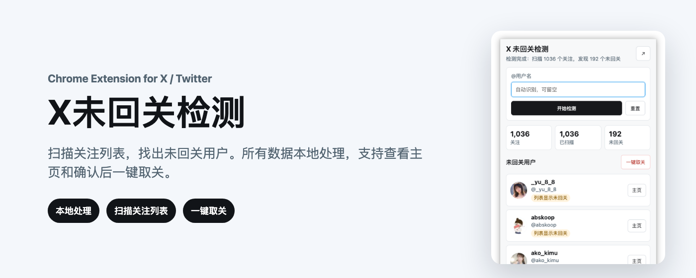
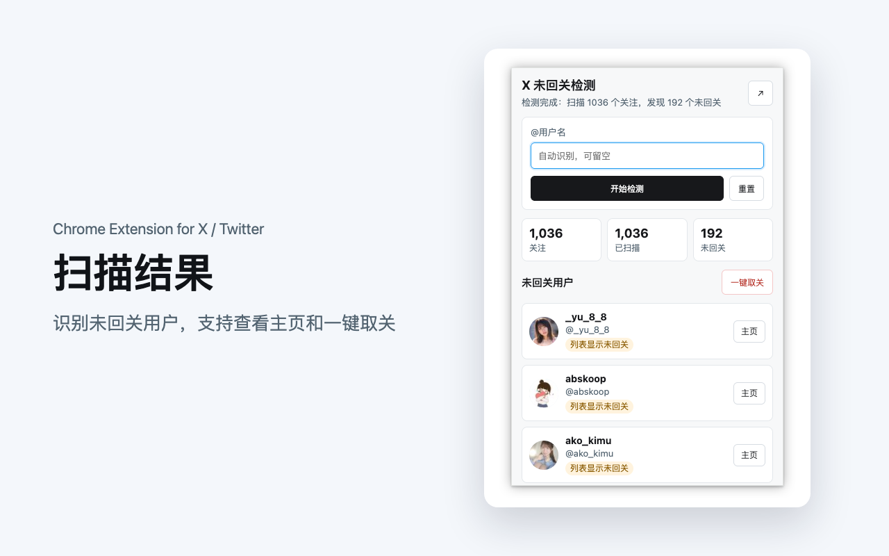
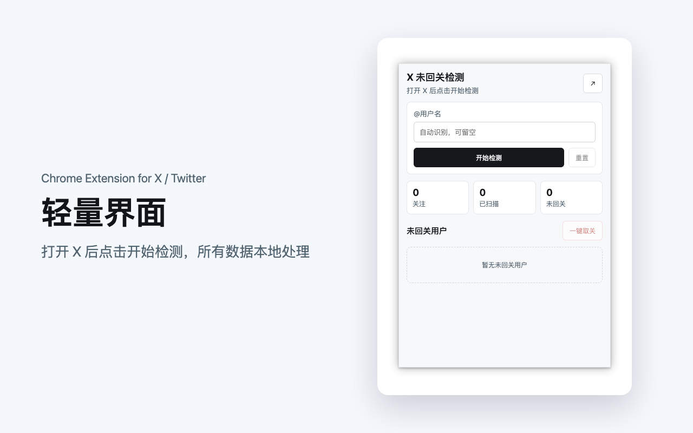
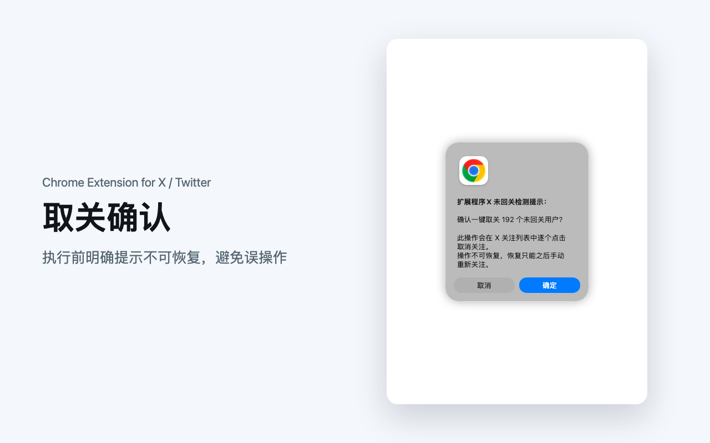

# X未回关检测 Chrome 插件



纯前端 Chrome MV3 插件，用于在 X（原 Twitter）网页上读取当前账号的关注列表，筛选关注列表中没有显示 `Follows you / 关注了你` 标记的用户。

X未回关检测是一款轻量级 Chrome 浏览器插件，适配新版 X（原 Twitter）网页。插件可以扫描当前登录账号的关注列表，识别“我已关注对方，但对方未回关我”的用户，并在弹窗或侧边面板中展示结果。

插件支持查看用户主页、一键批量取关、扫描进度展示等功能。所有数据仅在本地浏览器中处理，不上传到服务器，适合需要清理 X / Twitter 关注列表、检查互关关系、查找未回关用户的用户使用。

关键词：X未回关检测、Twitter未回关检测、X互关检测、Twitter互关检测、X取关工具、Twitter unfollow checker、X non followers checker、Twitter non followers。

## English

X Non-Follower Checker is a lightweight Chrome extension for the modern X, formerly Twitter, web app. It scans the current account's following list and detects users you follow who do not follow you back.

The extension provides a simple popup and side panel UI, profile review links, scan progress, and optional batch unfollow support. All data is processed locally in your browser and is not uploaded to any server.

Keywords: X non follower checker, Twitter non follower checker, X unfollow checker, Twitter unfollow checker, X follow back checker, Twitter follow back checker, X mutual follow checker, Twitter mutual follow checker.

## 文件结构

```text
.
├── manifest.json
├── README.md
├── _locales/
│   ├── en/messages.json
│   ├── zh_CN/messages.json
│   └── zh_TW/messages.json
├── popup/
│   └── popup.html
├── assets/
│   ├── icon16.png
│   ├── icon32.png
│   ├── icon48.png
│   └── icon128.png
├── store-assets/
│   ├── marquee-promo-1400x560.png
│   ├── small-promo-440x280.png
│   ├── screenshot-results-1280x800.png
│   ├── screenshot-empty-1280x800.png
│   └── screenshot-confirm-1280x800.png
├── docs/
│   └── privacy.html
├── src/
│   ├── background.js
│   ├── content.js
│   ├── panel-view.js
│   └── ui.js
├── scripts/
│   ├── package-extension.js
│   └── validate-extension.js
└── test/
    └── mock-x/
```

`src/panel-view.js` 是弹窗和页面浮层共用的界面，样式也写在里面。

## 多语言

插件界面跟随浏览器语言自动切换，目前有英文（`en`，默认）、简体中文（`zh_CN`）和繁体中文（`zh_TW`），文案在 `_locales/*/messages.json`。新增语言时复制一份 `en` 的文件翻译即可；`node scripts/validate-extension.js` 会检查各语言的 key 和占位符是否一致。

识别“是否回关”不依赖界面文字，X 设成任何语言都能正常检测。

## 安装

1. 打开 Chrome：`chrome://extensions/`
2. 开启“开发者模式”
3. 点击“加载已解压的扩展程序”
4. 选择本目录

## 使用

1. 在 Chrome 中登录 `https://x.com`
2. 点击插件图标
3. 点击“开始检测”
4. 插件会先打开你的主页读取关注总数，再进入 `/{你的用户名}/following` 滚动扫描；进度条显示进度和预计剩余时间
5. 扫描过程中，未回关用户会实时出现在列表里；中途点“停止”会保留已扫描的结果
6. 点击头像或名字可在新标签页打开对方主页；每一行都可以单独“取关”
7. 如需批量处理，可以先用搜索框筛选，再点“全部取关”或“取关这 N 位”，确认后插件会在关注列表中逐个取消关注

列表可以按“最近关注的在前”“最早关注的在前”或 A–Z 排序，选择会被记住。X 的关注列表本身按关注时间从新到旧排列，所以扫描顺序就是关注先后；X 不提供具体的关注日期。

浮层可以拖动（双击标题栏还原位置）、收起成小胶囊，并会跟随 X 的深色/浅色主题。如果插件未能自动识别当前账号，点“切换账号”手动填写自己的 X 用户名。

## 本地校验

```bash
node scripts/validate-extension.js
```

该命令会检查 `manifest.json`、HTML 引用路径和所有 JS 文件语法。

## 模拟页面测试

`test/mock-x/` 是一个模拟 X 关注列表的页面（日语界面、虚拟列表、分页加载、取关确认框），用来在不登录 X 的情况下测试扫描和取关逻辑：

```bash
python3 test/mock-x/server.py 8765 /path/to/old-content-dir
node test/mock-x/run-headless.mjs "http://127.0.0.1:8765/home?total=1500" "window.__harness.directScan()"
```

`directScan()` 会返回用时、漏扫数量、误判数量。第二个参数目录下放一个旧版 `content.js` 时，可用 `?impl=old` 对比新旧版本。

## 本地打包

```bash
node scripts/package-extension.js
```

打包产物会输出到 `dist/`，该目录不会提交到 GitHub。

## 商店素材

| 素材 | 文件 |
| --- | --- |
| Store icon | `assets/icon128.png` |
| Small promo tile | `store-assets/small-promo-440x280.png` |
| Marquee promo tile | `store-assets/marquee-promo-1400x560.png` |
| Screenshot - results | `store-assets/screenshot-results-1280x800.png` |
| Screenshot - empty | `store-assets/screenshot-empty-1280x800.png` |
| Screenshot - confirmation | `store-assets/screenshot-confirm-1280x800.png` |

## Screenshots







## 实现说明

- 不使用服务器，不上传账号数据。
- 不调用私有后端服务，依赖 X 网页 DOM 读取可见用户卡片。
- 检测只使用当前 X 标签页，不会批量打开用户主页。
- 检测时插件会进入关注列表页面，自动滚动收集你正在关注的用户。
- 只有卡片上有“正在关注”按钮（`data-testid` 以 `-unfollow` 结尾），且没有“关注了你”标记（`data-testid="userFollowIndicator"`）的人才会进入结果。两者都不依赖界面文字，所以任何 X 界面语言都能正确识别。
- 扫描时读取页面上已渲染的全部卡片（不只是屏幕内的），然后滚动到最后一张卡片处；新卡片一出现就继续，不用固定时间等待。
- 结果列表中的头像和用户名都可点击打开用户主页。
- 取关会在关注列表页面中查找目标用户并点击取消关注，不会逐个打开个人主页；会先跳到扫描时记录的大致位置再查找，每次取关之间有随机间隔。
- 如果 X 页面在插件安装前已经打开，后台会自动补注入页面脚本，不需要手动刷新。

X 网页 DOM 会变化，如 X 调整用户卡片或按钮结构，可能需要更新 `src/content.js` 中的选择器。

## Sponsor / 赞助支持

If this project helps you, consider sponsoring to support ongoing maintenance.

如果这个项目对你有帮助，欢迎赞助支持，让我能持续维护和更新。

- [GitHub Sponsors](https://github.com/sponsors/BryceYuuu): card / PayPal
- [爱发电 Afdian](https://afdian.com/a/bryce): 微信 / 支付宝 (WeChat Pay / Alipay)
